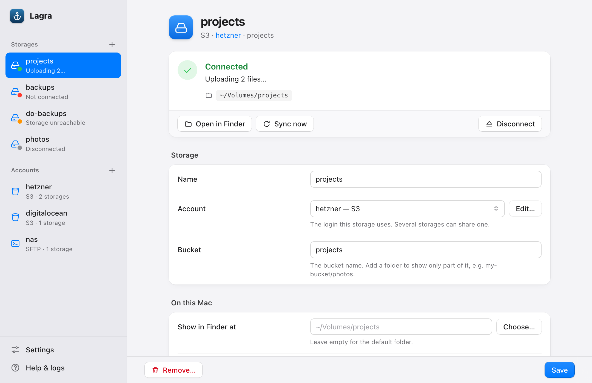
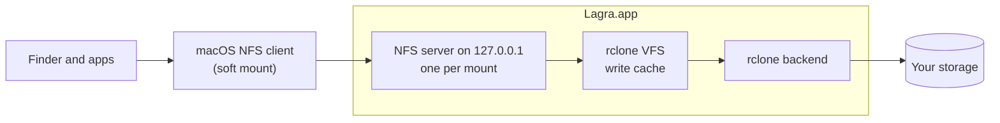

<p align="center">
  
</p>

<h1 align="center">Lagra</h1>

<p align="center">
  <strong>Your S3 buckets and file servers as Finder volumes.</strong><br>
  A small macOS menu-bar app keeps them connected through sleep, network changes and restarts,<br>
  configured by one file that can live in your dotfiles.
</p>

<p align="center">
  <a href="LICENSE"></a>
  
  
  
</p>

<p align="center">
  <picture>
    <source media="(prefers-color-scheme: dark)" srcset="docs/images/settings-dark.png">
    
  </picture>
</p>

## Why Lagra?

Getting a bucket into Finder usually means installing macFUSE, allowing a kernel extension and then keeping the mount alive yourself. Lagra uses what macOS already has: [rclone](https://rclone.org) serves each storage over NFS on `127.0.0.1`, and macOS mounts it with its built-in NFS client. Lagra watches every volume and repairs it when something goes wrong.

- **Real Finder volumes, nothing in the kernel.** No macFUSE, no kernel extension, no File Provider: rclone's NFS server and macOS's own `mount_nfs`, in one app.
- **Stays connected.** After sleep, a Wi-Fi change or a restart your volumes come back on their own, without asking for a password. A volume that is merely busy is told apart from a dead one, so a long download is not cut off by a reconnect.
- **Doesn't hang Finder.** Volumes are mounted *soft*: when the connection is gone, programs get an error instead of waiting forever.
- **One file, in your dotfiles.** Everything lives in one TOML file you can keep in git. Save it and Lagra applies the change within seconds, touching only the volumes that changed. A file with a mistake is rejected and the running setup stays. `lagra validate` works as a pre-commit hook.
- **Or click.** A native settings window edits the same file and keeps your comments outside the part you changed.
- **Secrets stay out of the file.** Keys and passwords go into the macOS keychain or come from a command such as the 1Password CLI, so the config can sit in a public repo.
- **Uploads you can see.** Saving is instant; files upload in the background. The menu shows pending uploads per volume, *Sync now* pushes them at once, and Lagra asks before you quit with uploads still waiting.
- **Clean buckets.** Finder's `._*` and `.DS_Store` files never reach your storage.

## Supported storage

- **S3-compatible:** AWS S3, Cloudflare R2, Hetzner, DigitalOcean Spaces, Wasabi, MinIO, Scaleway, OVHcloud, Google Cloud Storage (HMAC keys) and every other provider rclone knows
- **Servers:** SFTP, WebDAV (Nextcloud, ownCloud), SMB (NAS, Windows shares), FTP, HTTP (read-only)
- **More:** Backblaze B2, Azure Blob and Files, OpenStack Swift, Oracle Object Storage, Storj, Koofr, Mega, Seafile and others; `lagra backends` lists all 37

S3 is what Lagra is used with every day. The other kinds run on the same rclone code but have seen less real-world use so far; reports are welcome.

Not supported yet: services that sign in through the browser or keep a login session, such as Google Drive, OneDrive, Dropbox, iCloud Drive and Proton Drive. See [Limitations](#limitations).

## Installation

Requirements: macOS 14 (Sonoma) or newer, the Xcode Command Line Tools (`xcode-select --install`) and Go 1.27 or newer. There is no prebuilt download yet, so Lagra is built from source:

```sh
git clone https://github.com/eltupe/lagra.git
cd lagra
make install
```

`make install` builds `Lagra.app`, copies it to `/Applications` and links the `lagra` command to `~/.local/bin` (add that to your `PATH`). On the first run it creates a local code-signing certificate, and macOS asks for your login password once to trust it. That certificate keeps macOS from asking for file access and keychain access again after every update.

Without admin rights, install for your user only with `make install INSTALLDIR=$HOME/Applications`. `make uninstall` removes the app, the command and the login item; your config, cache, logs and keychain items stay.

## Getting started

### With the settings window

1. Open **Lagra** from Applications. An anchor appears in the menu bar.
2. Choose **Set up Lagra…** and add your first storage. Pick the kind (S3, SFTP, WebDAV, SMB, FTP or another), fill in the address and the login, then the bucket or folder.
3. Save. Lagra writes the config file, stores the secrets in the keychain and connects. The volume appears in Finder under `~/Volumes`.

To keep the config in your dotfiles, create the symlink before step 2. Lagra then writes into your repository:

```sh
mkdir -p ~/dotfiles/lagra ~/.config/lagra
ln -sfn ~/dotfiles/lagra/config.toml ~/.config/lagra/config.toml
```

### By hand

```sh
mkdir -p ~/dotfiles/lagra ~/.config/lagra
lagra config example > ~/dotfiles/lagra/config.toml     # fully commented, every setting
ln -sfn ~/dotfiles/lagra/config.toml ~/.config/lagra/config.toml
```

Describe an **account** (who you are: the login) and one **mount** per volume (where and how: the kind of storage, the bucket, server or folder). Several buckets behind the same keys share one account:

```toml
[[account]]
name = "aws"
[account.options]
provider = "AWS"
region = "eu-central-1"
[account.secrets]
access_key_id = { keychain = true }
secret_access_key = { keychain = true }

[[mount]]
name = "archive"
account = "aws"
type = "s3"                    # a kind from `lagra backends`
path = "my-bucket/archive"     # bucket, optionally followed by a folder
read_only = true

[[mount]]
name = "photos"
account = "aws"
type = "s3"
path = "photos"
```

A login that works on several servers, such as a company directory account, is one account too, even over different kinds of storage; each mount names its kind and its server, and takes the account's options its kind knows:

```toml
[[account]]
name = "company"
public = ["host", "user", "domain"]  # identifiers rclone calls sensitive, kept in the file
[account.options]
user = "alice"
domain = "CORP"
[account.secrets]
pass = { keychain = true }

[[mount]]
name = "team"
account = "company"
type = "smb"
path = "Team$"                # the share, optionally followed by a folder
[mount.options]
host = "files.example.org"

[[mount]]
name = "intranet"
account = "company"           # the same login over WebDAV; domain is SMB's alone
type = "webdav"
[mount.options]
url = "https://dav.example.org/files"
```

Store the secrets once, check the file and start:

```sh
lagra secret set aws access_key_id      # typed hidden, or piped from stdin
lagra secret set aws secret_access_key
lagra validate                          # exit code 1 on errors
open /Applications/Lagra.app            # or `lagra run` for a foreground daemon
lagra status
```

Set `launch_at_login = true` in `[general]` to start Lagra when you log in.

## Configuration

The config file is the single source of truth, whether you edit it by hand or in the settings window. Lagra looks for it at `--config <path>`, `$LAGRA_CONFIG`, `$XDG_CONFIG_HOME/lagra/config.toml` and `~/.config/lagra/config.toml`; symlinks are followed and written through. `~` and `${VAR}` work in paths, so one file can serve several Macs.

`lagra config example` prints every setting with its default and an explanation (also in [`config.example.toml`](config.example.toml)). `lagra options <type>` lists what a storage kind accepts, straight from rclone's metadata.

<details>
<summary><strong>All settings</strong></summary>

| Where | Field | Live? | Notes |
|---|---|---|---|
| `[general]` | `log_level` | yes | debug, info, warn, error |
| | `cache_dir` | restart | one rclone VFS cache root for the process |
| | `mount_probe_interval` | yes | local check of each volume, default 15s |
| | `backend_probe_interval` | yes | one cheap request per mount to the storage, default 60s |
| | `upload_stuck_after` | yes | one notification per mount, default 10m |
| | `launch_at_login` | yes | installs or removes the login item |
| `[defaults]` | `mount_root`, `read_only`, `enabled`, `hide_apple_files`, probe intervals, `[defaults.vfs]` | | merged into every mount; never storage options |
| `[[account]]` | `name` | key | `[a-z0-9][a-z0-9_-]*`; prefixes its keychain items |
| | `[account.options]` | restart | options its mounts share, passed 1:1 to rclone; each mount gets those its kind knows, see `lagra options <type>` |
| | `[account.secrets]` | restart | one source per sensitive option |
| | `public` | restart | sensitive non-password options you keep in the file, here or in its mounts |
| `[[mount]]` | `name` | key | `[a-z0-9][a-z0-9_-]*`; renaming = remove + add |
| | `account` | restart | the `[[account]]` it uses |
| | `type` | restart | a kind from `lagra backends`; mounts of one account may differ |
| | `path` | restart | rclone notation after the colon, e.g. `bucket/folder`; object stores need the bucket |
| | `[mount.options]` | restart | backend options for this mount alone, typically the server; override the account's, never secrets |
| | `mount_point` | restart | default `<mount_root>/<name>`; keep it under your home |
| | `read_only` | restart | enforced by rclone and by the NFS mount |
| | `enabled` | yes | `false` keeps the block but disconnects |
| | `mount_probe_interval`, `backend_probe_interval` | yes | override the `[general]` values for this mount |
| | `hide_apple_files` | restart | keep `._*`, `.DS_Store` and similar out; default true |
| | `[mount.vfs]` | restart | passed 1:1 to rclone's VFS, see `lagra options vfs` |

"Live" changes apply without touching the volume. Everything else disconnects and reconnects only that mount; changing an account reconnects the mounts that use it. Other mounts are never disturbed.

</details>

### Secrets

rclone marks some options as *sensitive* and some of those as *passwords*. Lagra keeps them out of the file:

- passwords (`pass`, key passphrases) always come from `[account.secrets]`;
- other sensitive options (S3 keys, but also an SFTP `host` or `user`) come from `[account.secrets]` unless the account lists them under `public = ["host", "user"]`, which also lets its mounts set them in `[mount.options]`.

Secrets belong to the account alone, so a login used on several servers is stored once.

A secret source is either the keychain (`{ keychain = true }`, item `<account>/<option>` under the service `lagra`) or a command whose output is the value, e.g. `{ command = ["op", "read", "op://Private/S3/secret"] }`. Commands time out after 10 s (`timeout = "30s"` to change it) and their output is never logged. A new secret reconnects the account's mounts.

## How it works



Each mount is in exactly one state, shown in the menu and by `lagra status`:

| State | Meaning | Lagra does |
|---|---|---|
| connected | volume present, storage answers | keeps checking |
| offline | volume present, storage unreachable (Wi-Fi off, VPN down) | keeps the volume and waits |
| broken | volume missing, stale or hung | starts a new server and mounts again; backoff 5 s to 5 min, forever |
| failed | permanent: missing secret, rejected options, a login the storage refuses, another mount on the mount point | waits for a config change, new credentials or a manual connect |
| connecting | server starting, mounting | |
| disconnected | turned off in the config, or disconnected by you (menu, `lagra unmount`, Eject in Finder) | nothing until you connect or the config changes |

A volume that is just busy (a folder with thousands of entries, a large file still downloading) is not broken. When it does not answer in time, Lagra asks its server directly and, as long as the server answers, waits up to 3 minutes before it mounts again. Each server works on up to 16 requests at once, so one slow request does not hold up the rest.

After waking from sleep or a network change every mount is checked at once. On start, mounts left behind by a crashed Lagra are cleaned up; mounts Lagra did not create are never touched. A manual disconnect lasts until you connect again, change that mount's config or restart Lagra; `enabled = false` is the persistent switch.

### Writing and syncing

Writes go through rclone's write cache (`vfs_cache_mode = full`). Saving returns as soon as the file is on your disk; the upload starts after `vfs_write_back` (5 s) and is retried until it succeeds. Pending uploads are shown per mount, disconnecting waits until they are done (`lagra unmount --force` overrides), quitting asks first, and uploads resume the next time Lagra starts. If uploads are stuck longer than `upload_stuck_after`, you get one notification.

| Direction | Delay | Setting |
|---|---|---|
| You save a file, it reaches the storage | `vfs_write_back` after the file is closed (5 s), then the upload | `[mount.vfs] vfs_write_back` |
| Someone else changes the storage, you see it in Finder | up to `dir_cache_time` (1 min) for listings; open files re-check on access | `[mount.vfs] dir_cache_time` |
| On demand | menu → mount → **Sync now**, the button in the settings window, or `lagra sync [name]` | |

S3 cannot notify clients of changes, so polling the listing is the only way to see them. S3 also has no real folders: Lagra sets rclone's `directory_markers = true` for S3 unless you set it yourself, so an empty folder you create is kept as a zero-byte `folder/` object, and a bucket or folder that does not exist is reported instead of showing up as an empty volume.

## Command line

```
lagra status [-v] [--json]     states, uploads, pending changes; -v adds the effective config
lagra mount <name>             connect (foreground single-mount mode if no daemon runs)
lagra unmount <name> [--force] disconnect; stays disconnected until mount or reload
lagra sync [name]              push pending uploads now and refresh the listing
lagra reload                   reload the config now (the daemon also reacts to SIGHUP)
lagra validate                 check the config; exit 1 if invalid
lagra settings                 open the settings page in your browser
lagra secret set|rm|check      manage keychain items: lagra secret set <account> <option>
lagra config path|example|edit
lagra backends                 storage kinds you can use in `type`
lagra options <type|vfs>       options with sensitive and required markers; --all adds advanced ones
lagra run                      foreground daemon without the menu bar
lagra quit [--force]           stop the daemon
lagra version
```

Files: state and the control socket in `~/Library/Application Support/lagra/`, logs in `~/Library/Logs/lagra/lagra.log` (rotated at 10 MB, five kept), cache in `~/Library/Caches/lagra/`, the login item at `~/Library/LaunchAgents/io.github.eltupe.lagra.agent.plist`.

## Limitations

- **Pre-release.** Lagra is used daily with S3 storage but has no stable release yet. Keep a copy of anything you cannot afford to lose.
- **No browser sign-in.** Google Drive, OneDrive, Dropbox, iCloud Drive, Proton Drive and other services that sign in through the browser (OAuth) or keep a login session are not offered yet: Lagra opens storage from config values and keeps nothing rclone writes back. Google Cloud Storage works through the S3 kind with HMAC keys.
- **Uploads are asynchronous.** A saved file is safe on your disk but not yet on the storage; programs never see upload errors. Watch the pending uploads.
- **No offline mode.** Without a connection you cannot browse the volume. The cache is a queue, not a copy, and there is no sync or conflict handling.
- **No extended attributes.** NFSv3 has none, so Finder tags and similar metadata are not stored; Lagra keeps the `._*` sidecar files macOS would write instead out of your storage. Leftovers from other tools can be removed with `rclone delete --include '._*'`.
- **Very large folders on slow storage.** macOS gives up on a request after somewhere between a few seconds and a minute. A folder with tens of thousands of entries behind a slow connection can take longer to list, and then fails with "Operation timed out".
- **`cp` and extended attributes.** Finder copies normally, but `cp` reports "could not copy extended attributes" and exits with an error, although the file arrives. Use `cp -X`, or set `hide_apple_files = false` to store the attributes as `._*` files.
- **SMB DFS namespaces.** rclone follows no DFS referrals, so a domain namespace such as `smb://example.org/Team` fails with "share … does not exist". Mount the share it points to instead; `smbutil dfs 'smb://DOMAIN;user@example.org/Team'` shows the target.
- **Finder sidebar.** Volumes under your home folder may not appear under *Locations*. Drag the folder into *Favorites* once.
- **Built locally.** Lagra is signed with a certificate made on your Mac, not with an Apple Developer ID, and is not notarized. Each Mac builds its own copy.
- **Size.** The app contains the rclone backends it offers and is about 80 MB.

## Troubleshooting

<details>
<summary><strong>Common problems</strong></summary>

- **The config has errors.** `lagra validate` names each one with its line. `lagra options <type>` lists what a storage kind accepts.
- **A mount is offline or failed.** The settings window shows the reason in plain words, with the technical details below. `lagra status -v` shows the merged configuration without secrets; `lagra secret check` shows which secret sources fail.
- **Logs.** Menu → *Open logs*, or `tail -f ~/Library/Logs/lagra/lagra.log`. `log_level = "debug"` also shows rclone's own messages.
- **"occupied by a mount lagra does not manage".** Something else, such as a hand-started `rclone nfsmount` or an SMB share, uses that mount point. Lagra never unmounts it; choose another `mount_point`.
- **"the server rejected the login".** Wrong user name, domain or password, or an account that is locked, disabled or expired. Lagra stops at the first refusal instead of trying again, because a directory service such as Active Directory locks the account after a few failed logins. Saving new credentials reconnects.
- **A mount stays broken.** The log has the last error and the retry schedule. A dead storage usually shows as offline instead; broken means the local server or the NFS mount itself failed.
- **macOS keeps asking for access.** Access is bound to the app's signature. Install with `make install`, which signs every build with the same local certificate (`make cert` creates it on its own), and allow access once. Settings → Permissions in the app shows the current state and opens the right System Settings pane.
- **Nothing works after changing `cache_dir`.** It needs a restart of Lagra.

</details>

## Contributing

Bug reports, test results with other storage kinds and pull requests are welcome. For larger changes, please open an issue first.

```sh
make test                   # go test -race ./...
make vet
make build                  # bin/lagra
go run ./hack/uipreview     # the settings page against a fake daemon; open the printed URL
```

- `cmd/lagra`: the command line, and the app when started from the bundle
- `internal/app`: the daemon, wiring everything below; `internal/menubar` and `internal/window` (a WKWebView shell in Objective-C) are its macOS faces
- `internal/config` (load, validate, merge, diff), `internal/secrets` (keychain, commands), `internal/settings` and `internal/tomledit` (how the settings window writes the file), `internal/webui` (the settings page and its local API)
- `internal/engine` (one state machine per mount, wake and network watchers), `internal/rclone` (the only package importing rclone: offered backends, NFS server, Apple filter), `internal/sysmount` (mount_nfs, diskutil, mount table, probes)
- `internal/ipc`, `internal/reload`, `internal/state`, `internal/launchagent`, `internal/logging`, `internal/notify`, `internal/atomicfile`: control socket, file watcher and the rest

Design decisions are recorded in [`docs/adr/`](docs/adr/); how Lagra uses rclone, go-nfs and macOS, and why, is in [`docs/internals.md`](docs/internals.md); how a release is built, signed and published, in [`docs/releasing.md`](docs/releasing.md).

## Acknowledgements

Lagra is built on [rclone](https://rclone.org) (MIT) and [go-nfs](https://github.com/willscott/go-nfs) (Apache-2.0). Its mount options and the idea of probing volumes come from [grrclone](https://github.com/mlaify/grrclone) (MIT). The other Go modules it links are under MIT, BSD, Apache-2.0, ISC, MPL-2.0, LGPL-3.0 and CC0 licenses, all compatible with the GPL. Their license texts ship with the app in `Lagra.app/Contents/Resources/THIRD_PARTY_NOTICES.txt`; `go run ./hack/notices` prints them from source.

## License

Copyright (C) 2026 Michael Schlegel

Lagra is free software: you can redistribute it and/or modify it under the terms of the GNU General Public License as published by the Free Software Foundation, either version 3 of the License, or (at your option) any later version. It is distributed in the hope that it will be useful, but WITHOUT ANY WARRANTY; without even the implied warranty of MERCHANTABILITY or FITNESS FOR A PARTICULAR PURPOSE. See [LICENSE](LICENSE) for the full text.
